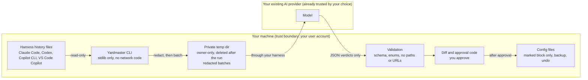

# Data flow

## Statement

Local history files are read (read-only) by Yardmaster. It writes redacted batches into a private temporary directory.
Those batches go to **the same AI provider the user's harness already uses**, through that harness. The model's JSON
verdicts come back, are validated locally, and are written, after the user approves a diff, into local config files.

**No other egress exists, and none is possible from Yardmaster code**: the runtime imports no network module, and the
whole test suite runs with sockets blocked (control S2; `tests/unit/test_smoke.py::test_no_network_guard_active`).

## Diagram

## What crosses each boundary

| Step | Data | Protection |
|---|---|---|
| History to Yardmaster | Chat text, token counts, model names | Read-only open, SQLite `mode=ro`, containment check, no symlinks followed, size caps (S4) |
| Yardmaster to temp dir | Redacted, fenced, nonce-labelled batches | Secrets redacted before batching, optional PII redaction (S5); owner-only directory, deleted in `finally` (S8) |
| Temp dir to the model | The same redacted batches | Sent by **your harness** to **your provider**, as any chat would be. `preview` shows exactly what. Cost and batch-count gates need your confirmation (S9) |
| Model to Yardmaster | `verdicts.json`, `plan.json` | Schema-only; no paths, URLs or code fences in free text; model ids checked against the chat's own harness (S6) |
| Yardmaster to config files | A marked block of text | Allow-listed names, contained in the project root or harness config dir, symlinks refused, hash re-checked at apply, atomic replace, backup, `undo` (S7) |

## What does not happen

- No upload to Yardmaster's author or any third party. There is no telemetry, analytics or update check.
- No chat text in logs, run records, the ledger or error messages (S11).
- No code is fetched or executed (S1, S3).
- The temporary batches are not kept after the run.

Trust boundaries and the adversaries behind them are in [threat-model.md](threat-model.md).
